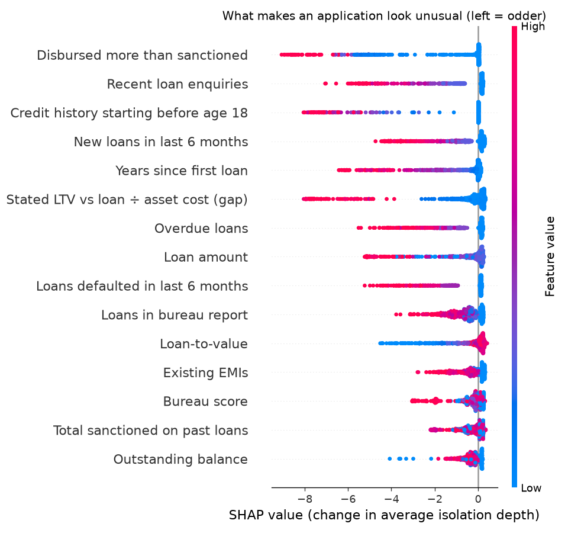

# Model 4: Anomaly detector (model card)

| | |
|---|---|
| **Job** | Flags applications that are **unusual** or **impossible**, including new fraud patterns no labelled model has seen. It's part of the *Fraud & documents* gate (gate 3), alongside [model 3](../fraud_classifier/README.md). |
| **Type** | Two layers: an **IsolationForest** for unusual combinations, plus **integrity rules** for details that can't all be true together. **SHAP** gives the reasons. |
| **Trained on** | [L&T Vehicle Loan Default](https://www.kaggle.com/datasets/mamtadhaker/lt-vehicle-loan-default-prediction) only, real Indian loans, **with the labels removed** |
| **Status** | Trained and tested. It catches **84% of planted odd applications** while flagging **1.2%** of real ones. The forest alone misses single inflated amounts. |
| **Version** | `anomaly-v1`, trained 5 Nov 2026 (500 trees) |
| **Owner** | AI/ML member |

## How it works

1. **The IsolationForest learns what normal looks like.** It trains on 1,34,790 real August–September 2018 applications, with no labels at all. Trees split the data at random. An unusual application gets isolated in few splits, so it gets a **high anomaly score**.
2. **Integrity rules catch impossible applications.** A forest can't learn a combination that *never* happens in genuine data, because to the forest that input is always 0. So these are checked directly. The limits come from what's logically impossible or never seen in real L&T data. **They were not tuned on the test cases.**

   | Rule | Breaks when |
   |---|---|
   | LTV mismatch | Stated LTV differs from loan ÷ asset cost by more than 10 points. Real L&T LTVs are usually about 2 points above it, because fees are added. |
   | Score without loans | A bureau score, but no loans of any kind on record |
   | History before 16 | Credit history would have started before age 16 |
   | Count contradiction | More active, overdue or defaulted loans than loans on record |
   | Over-disbursed | Past loans disbursed at more than 2× the amount sanctioned |
3. **Alert levels:**

   | Alert | When | Engine action |
   |---|---|---|
   | `normal` | Neither layer fires | Carries on |
   | `unusual` | Forest score in the top **1%** of training applications | **Refer** to the fraud team, `R-FRD-04` |
   | `very_unusual` | Forest score in the top **0.1%**, **or** any integrity rule broken | **Refer**, top of the queue, `R-FRD-04` |

   Like model 3, **it never rejects and never declares fraud.** An odd application can be perfectly genuine, so it goes to a person.

## Inputs (15, from the L&T application and bureau fields)

Loan amount, LTV, the LTV-vs-amount gap, bureau score, loans in the bureau report, overdue loans, outstanding balance, total sanctioned, disbursed-over-sanctioned, existing EMIs, new loans in the last 6 months, loans defaulted in the last 6 months, recent enquiries, years since first loan, and credit history starting before 18.

Amounts and counts go through a log scale, so a few huge values don't swamp the splits.

**Left out on purpose:**
- **State, pincode and branch.** A rare *location* must never make an application look odd.
- **Dealer, manufacturer and staff IDs.** These IDs have no order, and they describe the dealer or staff, not the applicant.
- **Aadhaar, PAN and other ID flags.** Aadhaar is voluntary, so choosing a different ID must not look suspicious.
- **Age on its own.** A very young or old applicant is rare but not suspicious. Age is used *only* to spot a credit history that starts before 18.

**Dropped after testing:**
- **Inputs that never vary in real data.** The integrity rules cover those instead.
- **Near-duplicates:** asset cost, active loans, disbursed total and average loan age.
- **The 0/1 employment flags.**
- **"Average loan age longer than credit history."** It's 0 for every real application.

## How we tested it

The test month (October 2018, 98,364 real applications) is never used for training. To measure what it **catches**, we planted **3,000 fake odd applications**: real October applications copied and altered in 6 ways, 500 of each. These altered copies exist only in memory during the test and are never saved.

| Planted type | What was changed | Kind | Caught by forest | Caught by rules | **Caught in total** |
|---|---|---|---|---|---|
| Loan stacking | 6–12 new loans and 8–20 enquiries in 6 months, with matching EMIs | extreme | **96.8%** | 0% | **96.8%** |
| Inflated loan | Loan and asset cost both 4–8× normal, LTV still consistent | extreme | **6.0%** | 0% | **6.0%** |
| Impossible history | Credit history starting at age 2–8 | contradiction | 100% | 100% | **100%** |
| Tampered LTV | Stated LTV cut 30–50 points below loan ÷ asset cost | contradiction | 87.0% | 100% | **100%** |
| Over-disbursed | Past loans disbursed at 2–4× the sanctioned amount | contradiction | 24.0% | 100% | **100%** |
| Borrowed score | Bureau score 780–890 with no loans on record | contradiction | 0.2% | 100% | **100%** |
| **All 3,000** | | | **52.3%** | 66.7% | **83.8%** |

**How to read this honestly:**
- **The rules catch every contradiction because they test exactly those conditions.** That's expected, not impressive. The real test of the machine learning is the **forest column**.
- **The forest catches odd *combinations* well,** such as loan stacking (97%) and tampered LTV (87%).
- **It's poor at a single inflated value** when everything else looks normal (6%). Some genuine L&T loans are already that large (up to ₹9.9 lakh), and a tree only rarely splits on that one input. In Nirnay, inflated amounts are also checked by the **policy limits** and the **property valuation model (model 7)**.
- **Larger trees mattered.** With scikit-learn's default 256 samples per tree and all 24 inputs, the forest caught only **19%**. With 8,192 samples and 15 inputs, it catches **52%** at the same 1% flag rate.

**Real October applications** (`reports/metrics.json`):

| | Share flagged |
|---|---|
| By the forest (set for 1% on training months) | 1.12% |
| By the integrity rules | 0.29%: 167 "history before 16", 115 "over-disbursed", 7 "LTV mismatch" |
| **In total** | **1.21%**, of which `very_unusual` 0.38% |

So genuine data does trip the rules sometimes, mostly through birth-date or bureau-record errors. That's still worth a person's look.

**Sanity check:** flagged applications defaulted slightly more often than the rest, 24.6% against 23.5%. The detector is about *odd* applications, not *risky* ones, so a big difference wasn't expected.

## What drives a flag

`reports/shap_importance.csv` and the chart below show what drives a flag. The top drivers are:
- disbursed more than sanctioned
- recent enquiries
- credit history starting before 18
- new loans in 6 months
- years since first loan
- the LTV gap



Each dot is one flagged or planted application. Dots further **left** made it easier to isolate, meaning odder. Red means a high value of the input. For example, many enquiries (red) push applications far to the left.

## Fairness

Share of **real** October applications flagged (`reports/fairness.csv`):

| Group | Flagged |
|---|---|
| Age under 30 | 0.85% |
| Age 30–44 | 1.28% |
| **Age 45–59** | **1.88%** (2.2× under-30s) |
| Employment: salaried / self-employed | 0.99% / 1.18% |
| **Employment: missing** | **4.14%** |
| States (18 with enough applicants) | 0.18% to 2.97% |

**What these gaps mean:**
- **Age.** Older applicants are flagged more, even though age isn't an input. Their long credit histories and many past loans are rarer in this data, where half the borrowers are new to credit.
- **Employment and state.** Missing employment details and some states also get flagged more. State isn't an input either.
- **The impact is limited:** a flag only sends an application for review, and the overall rate is about 1%. But these gaps should be monitored, and reviewed by the model risk committee before any live use.

## Output (what the Fraud gate receives)

`example_input.json` is a normal application. It scores **0.369 (47th percentile), `normal`, flag `pass`**. Three altered versions:

| Change | Score | Alert | Top reason |
|---|---|---|---|
| 9 new loans, 14 enquiries, EMIs ₹25,000 | 0.529 (99.2th pct) | `unusual` → refer | "Recent loan enquiries (14): higher than 99.98% of past applications" |
| Stated LTV 35 instead of about 76 | 0.533 | `very_unusual` → refer | "Integrity check failed: Stated LTV differs from loan / asset cost by more than 10 points" |
| Score 850 with no loans on record | 0.374 (forest: normal) | `very_unusual` → refer | "Integrity check failed: Bureau score present but no loans of any kind on record" |

The last row shows why the rules are needed: the forest alone rated that application **normal**.

**Fields returned:**
- `anomaly_score`, plus its `percentile` among training applications
- `alert`, plus `forest_alert` and `rules_broken` showing which layer fired
- `flag`
- `reason_code` (`R-FRD-04`)
- each input's SHAP `contributions`
- `top_reasons`, each naming how rare the value is

## Run it

```bash
.venv\Scripts\python -m pip install -r models/anomaly_detector/requirements.txt
```
```bash
.venv\Scripts\python -m models.anomaly_detector.train
```
```bash
.venv\Scripts\python -m models.anomaly_detector.detector models/anomaly_detector/example_input.json
```

**Before training:** the L&T `train.csv` must be in `data/raw/lt_vehicle_loan/`. Training takes about 2 minutes.

**Speed:** loading takes about 2 seconds. The **first** score takes about 13 seconds while SHAP builds its explainer, and every score after that takes about 0.1 seconds. A server should load it once at startup.

**Tests:** 14 tests on made-up data, run with `.venv\Scripts\python -m pytest`. They use a smaller forest so they finish in about 17 seconds. They check that:
- about 1% of real applications get flagged,
- the planted cases get caught,
- SHAP adds up to the score,
- alerts only ever refer,
- age alone never changes the score,
- impossible details break the rules.

**Model file safety:** `model.joblib` (12 MB) is a Python pickle, and loading a pickle can run code. Only ever load the file that `train.py` wrote into this repo. The detector warns if your scikit-learn version differs from the one it was trained with (1.9.1). If you see that warning, retrain.

## Next steps

- Feed back officer decisions on flagged cases (genuine or not) to tune the 1% / 0.1% levels.
- Add income-based checks (EMI ÷ income) once the lender's data includes income.
- Watch the age and employment gaps monthly.
