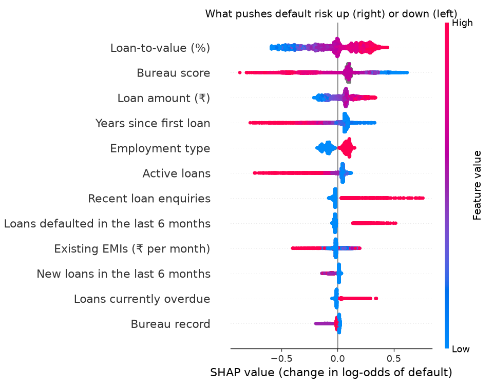

# Model 2: Credit challenger (model card)

| | |
|---|---|
| **Job** | A second opinion on credit risk. It runs in **shadow mode**: the engine logs its score next to the scorecard's, but it **never sets the outcome**. If it keeps beating the scorecard on live loans, the model risk committee can decide whether to promote it. |
| **Type** | LightGBM gradient-boosted trees with **monotonic constraints**. **SHAP** values give the reasons. |
| **Trained on** | The same [L&T Vehicle Loan Default](https://www.kaggle.com/datasets/mamtadhaker/lt-vehicle-loan-default-prediction) data and the same out-of-time split as [model 1](../credit_scorecard/README.md) |
| **Status** | Trained and validated. It is **clearly better than the scorecard** (AUC +0.026), but still weak on this data. |
| **Version** | `challenger-v1`, trained 5 Nov 2026 (181 trees) |
| **Owner** | AI/ML member |

## Why a challenger

A scorecard adds up one input at a time. A tree model can also learn **combinations**. For example, a high LTV matters more when there's no bureau history. Running both lets us measure whether the extra accuracy is worth a more complex model. Until it's proven on live loans, the explainable scorecard stays in charge.

## How it's kept safe and explainable

1. **Same inputs, same exclusions.** It doesn't use state, pincode, branch, dealer, staff IDs or ID-document flags, the same rules as the scorecard.
2. **Age is left out, too.** With age, under-30s were approved at **0.19×** the rate of the best age group. Without it they're at **0.45×**, and accuracy drops by only 0.002 AUC. Age is still used to *check* fairness.
3. **Monotonic constraints.** Where the direction is obvious, risk can only move one way:

   | Input | Risk can only… as the input rises |
   |---|---|
   | Bureau score, years since first loan | go **down** |
   | Loan-to-value, loan amount, recent enquiries, loans defaulted in last 6 months, loans currently overdue | go **up** |
   | Employment type, active loans, existing EMIs, new loans in last 6 months, bureau record | free (no obvious direction) |

   LightGBM's `advanced` and `intermediate` methods let small wrong-way steps through on this data, so we use `basic`, which never did. Training also **checks** this itself. It sweeps every constrained input across 50 real applicant profiles and stops with an error if risk moves the wrong way even once.
4. **SHAP becomes points.** Each applicant's SHAP values are turned into points in the scorecard's own scale: 50 points doubles the odds. The score equals **650 + the sum of the points**, so an officer reads both models the same way.
5. **Out-of-time training.** It learns on August, picks the number of trees on September, retrains on August and September, and is tested only once, on October.

## Results on L&T data (test = Oct 2018, 98,364 loans it never saw)

| Measure | Scorecard (model 1) | **Challenger (model 2)** | Difference |
|---|---|---|---|
| AUC | 0.595 | **0.621** | **+0.026** |
| Gini | 0.189 | **0.241** | +0.052 (28% better) |
| KS | 0.141 | **0.178** | +0.038 |
| Approved (grade A/B) | 6.8% | **9.7%** | +2.9 points |

- **The gain is real.** Resampling the test loans 200 times gives a 95% range of **+0.024 to +0.028** AUC. The range never touches zero, so this isn't luck.
- **Train AUC is 0.644 against 0.621 on test.** That's a small gap, so there's no serious overfitting.
- **It's still weak overall** (Gini 0.24, where lenders want 0.4 or more), for the same reasons as model 1. The data is first-EMI default on two-wheelers, half the borrowers have no bureau history, and there's no income data.

**Grades** (`reports/grades.csv`). Default rates rise steadily, with a wider spread than the scorecard's:

| Grade | Applicants | Share | Actual default | Predicted |
|---|---|---|---|---|
| A | 763 | 0.8% | **5.9%** | 3.9% |
| B | 8,752 | 8.9% | 11.2% | 8.7% |
| C | 34,283 | 34.9% | 18.0% | 15.2% |
| D | 49,534 | 50.4% | 28.1% | 25.0% |
| E | 5,032 | 5.1% | **40.6%** | 37.6% |

The scorecard had **no** grade-A loans, and its E grade had just 38. The challenger separates the safest and riskiest borrowers much better. Like the scorecard, its predictions run about 3 points low, because October's default rate jumped. It also needs recalibrating on recent loans.

**Where the two models disagree** (`reports/decision_swap.csv`). They make the same decision 77.4% of the time. When they differ, the challenger is usually right:

| Scorecard said | Challenger said | Loans | Actual default |
|---|---|---|---|
| refer | **approve** | 5,115 | 11.6%, safer than all of the scorecard's approvals (12.8%) |
| refer | **reject** | 9,848 | 28.2%, as risky as all of the scorecard's rejects (28.4%) |
| approve | refer | 2,260 | 17.6%, much riskier than the loans both models approve (9.9%) |

**What drives the score** (`reports/shap_importance.csv`, average points moved per applicant):

| Input | Avg points | | Input | Avg points |
|---|---|---|---|---|
| Loan-to-value | 15.6 | | Recent enquiries | 3.5 |
| Bureau score | 14.3 | | Loans defaulted in last 6 months | 2.8 |
| Loan amount | 7.8 | | Existing EMIs | 2.6 |
| Years since first loan | 7.0 | | New loans in last 6 months | 1.7 |
| Employment type | 6.4 | | Loans currently overdue | 1.2 |
| Active loans | 5.2 | | Bureau record | 1.1 |



Each dot is one applicant. Dots to the right raised that applicant's risk. Red means a high value of the input, blue a low one. For example, a high LTV (red) pushes risk up, and a high bureau score (red) pushes it down.

**Fairness** (`reports/fairness.csv`, approve = grade A/B):
- **Age:** under-30s are approved at **0.45×** the rate of 60+, against 0.49× with the scorecard. Ages 30–44 are at 0.68× and 45–59 at 0.79×. All three still fall below the four-fifths rule (0.8). The 60+ group is small (598 applicants), which makes the ratios jumpy.
- **State:** 8 of 18 states fall below 0.8, against 10 with the scorecard.
- **Both need investigating before any live use.**

## Output (what the decision engine logs)

`example_input.json` from model 1, scored by the challenger:

```json
{
  "model": "credit_challenger",
  "mode": "shadow",
  "model_version": "challenger-v1",
  "trained_on": "lt",
  "score": 719,
  "grade": "B",
  "flag": "pass",
  "reason_code": null,
  "probability_of_default": 0.0826,
  "base_score": 650,
  "points": [{"input": "bureau_score", "label": "Bureau score", "group": "Repayment history",
              "value": 742.0, "shap": -0.45029, "points": 32}, "... one entry per input ..."],
  "top_reasons": ["Existing EMIs (₹ per month) (1800.0): -6 points", "Active loans (1.0): -5 points",
                  "New loans in the last 6 months (0.0): -1 points"]
}
```

The scorecard gave this applicant 715 (B). An applicant with no bureau history and 90% LTV scores **608 (D)**. Their reasons are "Loan-to-value (90.0): −27 points", "Bureau score (missing): −8 points" and "Years since first loan (0.0): −7 points".

Inputs with no constraint can give reasons that look odd. Here, *having* one active loan costs 5 points. That's what the data shows, and SHAP reports it honestly. If the risk team disagrees, it can add a constraint and retrain.

## Run it

Train the scorecard first, because the challenger compares itself with it. Then, from the repo root:

```bash
.venv\Scripts\python -m pip install -r models/credit_challenger/requirements.txt
```
```bash
.venv\Scripts\python -m models.credit_challenger.train
```
```bash
.venv\Scripts\python -m models.credit_challenger.challenger models/credit_scorecard/example_input.json
```
```bash
.venv\Scripts\python -m pytest
```

Training takes about 1.5 minutes. Most of that is the SHAP values for 2.3 lakh loans and the resampling. There are 18 challenger tests, run on made-up data. They check that:
- the SHAP points add up to the score,
- the SHAP library and LightGBM give the same values,
- every constrained input moves risk the right way,
- a bureau score of 0 counts as "no score",
- age and location inputs are never used.

## Next steps

- **Shadow on live traffic.** Log both models for every application, and compare their default rates by month once repayment data arrives.
- **Recalibrate** both models on the latest month.
- **Look into the age and state gaps** before any promotion.
- **Retrain on Home Credit** once the Kaggle account is phone-verified.
