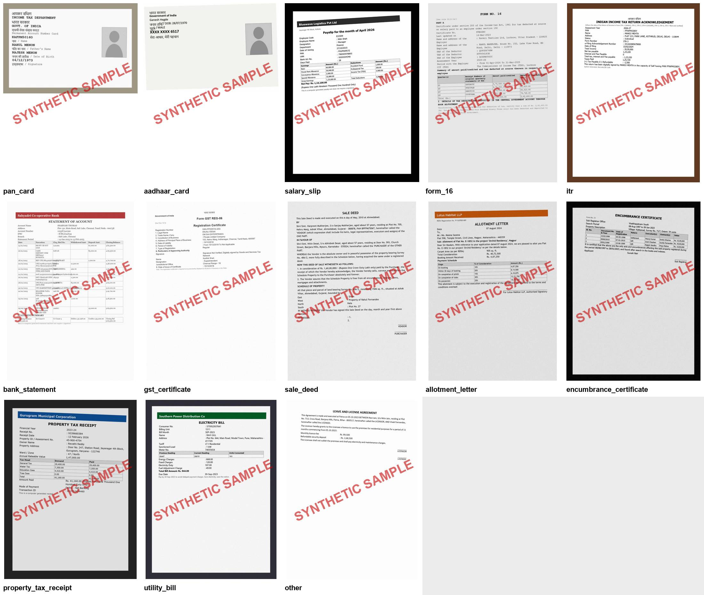

# Model 6: Document classifier (model card)

| | |
|---|---|
| **Job** | Reads the OCR text of an uploaded document and says what it is: a PAN card, salary slip, Form 16, bank statement, sale deed and so on. The *Documents* gate (gate 5) then checks that each upload slot holds the right paper before other models read the fields. |
| **Type** | TF-IDF (words + character fragments with spaces removed), then logistic regression |
| **Trained on** | **480 fake documents we generate** (36 for each of 12 lending types, plus 48 "other" papers), drawn as images, made to look like phone photos, and read back with a real OCR engine. Plus 130 bad photos of them, and 54 scanned statements and ITRs from [AgamiAI](https://huggingface.co/datasets/AgamiAI/Indian-Bank-Statements) (synthetic, Apache-2.0). **No real customer papers.** |
| **Status** | Trained and tested. **88% accuracy on layouts it has never seen** (macro F1 0.88). **100% on AgamiAI's scans** from a model trained only on our documents. **No wrong type was accepted** in any check: unsure answers go for review. |
| **Version** | `doc-classifier-v1`, trained 5 Nov 2026 |
| **Owner** | AI/ML member |



## The 13 types

| KYC | Income | Property | Other |
|---|---|---|---|
| `pan_card`, `aadhaar_card` (masked) | `salary_slip`, `form_16`, `itr`, `bank_statement`, `gst_certificate` | `sale_deed`, `allotment_letter`, `encumbrance_certificate`, `property_tax_receipt`, `utility_bill` (address proof) | `other`: anything else |

Each type comes in **5 layouts**, meaning different issuers and formats of the same paper (`generator.py`). "Other" has 8.

| Type | Layouts |
|---|---|
| PAN card | new card, old card, e-PAN, firm/company card, PAN allotment letter |
| Aadhaar | card front, card back, e-Aadhaar letter, masked Aadhaar print, PVC card |
| Salary slip | corporate payroll, small firm, government pay slip, pay advice, wage slip (Form XIX) |
| Form 16 | Part A, Part B, TRACES summary, new-regime Part B, payroll-software summary |
| ITR | ITR-V, e-filing acknowledgement, ITR-1 SAHAJ, ITR-4 SUGAM, CA's computation of income |
| Bank statement | statement of account, account statement with customer block, passbook, monthly e-statement, current account |
| GST | REG-06 certificate, Annexure A, Annexure B, portal search printout, REG-25 provisional certificate |
| Sale deed | sale deed, deed of conveyance, e-stamp page with registration endorsement, apartment sale deed, plot sale deed with khata |
| Allotment letter | builder letter, development-authority allotment-cum-demand, provisional allotment, industrial plot, booking e-mail |
| Encumbrance certificate | Form 15 EC, Form 16 nil EC, online state EC, statement of encumbrances, village officer's certificate |
| Property tax | municipal receipt, online payment receipt, gram panchayat receipt, self-assessment challan, demand bill |
| Utility bill | electricity, piped gas, water, phone and broadband, spot-billing slip |
| Other | leave and licence agreement, credit card statement, offer letter, hospital invoice, insurance policy schedule, school fee receipt, restaurant bill, driving licence |

Some look-alikes are there on purpose:
- A **nil encumbrance certificate is also "Form No. 16"**, under the Registration Rules.
- A **salary slip and a Form 16** both come from the employer and show pay and PAN.
- A **sale deed and an allotment letter** both describe a property sale.
- A **credit card statement and a bank statement** both list transactions.

## The data, and why it's built this way

We found no public labelled set of Indian lending documents. The sets we checked:

| Source | Used? | Why |
|---|---|---|
| **Our generator** (`generator.py` → `render.py` → `ocr.py`) | **Yes, for training** | Every type and layout we need. The names, firms, banks and builders are made up, and every number is random. Aadhaar numbers are always masked (XXXX XXXX 1234), as UIDAI requires. |
| [AgamiAI Indian Bank Statements](https://huggingface.co/datasets/AgamiAI/Indian-Bank-Statements) and [Income Tax Returns](https://huggingface.co/datasets/AgamiAI/Indian-Income-Tax-Returns) (HF, Apache-2.0) | **Yes, as the outside test** | Synthetic, made by a *different* generator, then printed and **scanned**. We use 24 statements and 30 ITRs, about 200 MB, kept in `data/raw/agami/`, which Git ignores. Only page 1 is read. |
| Roboflow Aadhaar/PAN image sets | No | They appear to be photos of real people's ID cards, so they're personal data under the DPDP Act. |
| [clean_deed](https://huggingface.co/datasets/JAYASREESS/clean_deed) (HF) | No | It's a single PDF of unclear origin, and its card mentions Aadhaar numbers. |
| GROGU-KYC (IEEE DataPort) | No | It needs an IEEE login, and it has no deeds and no Form 16. |
| RVL-CDIP | No | US office papers (letters, memos, forms). None of our types. |

**Why real OCR, and not clean text:** the engine gets OCR text, and OCR text is messy, as `example_ocr.txt` shows:
- Labels come out separated from their values.
- Words run together ("PermanentAccountNumberCard").
- Digits get misread (`60.080.00`).
- Hindi comes out as junk.

So each fake document is drawn as an image, made to look like an upload, then read with **RapidOCR**. RapidOCR runs the PP-OCR models locally and sends nothing to any web service. Making an upload look real means:
- a slight tilt, blur and noise
- JPEG compression
- sometimes a table-top background with perspective

The 130 **bad photos** are harder still:
- half the page cut off
- heavy blur
- low resolution
- a strong tilt
- a dark photo

Building the data takes about 30 minutes on a laptop (`build_data.py`). The OCR text is committed as `data/generated_ocr.csv`, so training takes about 3 minutes and needs no OCR.

## How it works

1. **Two views of the text.** The model reads two versions of the same text:
   - Words and word pairs, for clean text.
   - Character fragments (3–5 characters) with **all spaces removed**, so "Form No. 16" and "FormNo.16" look the same. This keeps the model working when OCR engines space words differently.
2. **Numbers don't count.** Every number becomes `#`, so PANs, amounts and dates don't steer the answer.
3. **Classify.** Logistic regression with balanced classes gives each type a probability.
4. **Decide.** The engine acts on the result:
   - **Fewer than 60 letters or digits:** `unreadable`. The customer is asked for a clearer photo (`R-DOC-02`).
   - **Confidence below 0.5:** `needs_review`. An officer checks the type.
   - **A different type from the one the slot asked for, or "other":** `refer` (`R-DOC-01`).
5. **Explain.** The words that pushed hardest towards the answer are returned as `reasons`, for example `tds`, `section`, `employee` for a Form 16.

## Results: accuracy

Every check holds out **whole layouts**, five times over. So each score measures formats the model has never seen, like a payroll system or a state's EC format we didn't write.

| Check | Accuracy | Macro F1 | Accepted automatically | **Wrong but accepted** |
|---|---|---|---|---|
| **Unseen layouts**, normal photos (480) | **0.883** | 0.875 | 65% | **0** |
| Unseen layouts, **bad photos** (130) | 0.785 | 0.775 | 48% | **0** |
| Unseen layouts, **clean text** (as from a text PDF or a better OCR engine) | 0.875 | 0.861 | 68% | **0** |
| **Outside source: AgamiAI scans**, trained on our documents only (54) | **1.000** | 1.000 | 100% | **0** |

AgamiAI broken down: bank statements type 1 12/12, type 2 12/12, ITRs 30/30.

**F1 per type** (`reports/per_category.csv`):

| Type | Unseen layouts | Bad photos | Clean text |
|---|---|---|---|
| pan_card | 1.00 | 0.95 | 1.00 |
| aadhaar_card | 0.92 | 0.70 | 0.92 |
| salary_slip | 1.00 | 0.89 | 1.00 |
| form_16 | 1.00 | 0.89 | 1.00 |
| itr | 1.00 | 0.95 | 1.00 |
| bank_statement | 0.88 | 0.64 | 0.92 |
| gst_certificate | 1.00 | 1.00 | 1.00 |
| sale_deed | 0.88 | 0.78 | 0.82 |
| allotment_letter | 0.85 | 0.54 | 0.86 |
| encumbrance_certificate | 0.91 | 0.90 | 0.91 |
| property_tax_receipt | 0.92 | 0.90 | 0.88 |
| utility_bill | 0.82 | 0.78 | 0.82 |
| other | **0.20** | 0.17 | 0.07 |

**Key findings:**
- **Every core lending type is recognised**, even in formats it has never seen: PAN, Aadhaar, salary slip, Form 16, ITR, bank statement and GST all score 36/36. So does the "Form No. 16" look-alike: a nil EC is never called a Form 16, and the reverse never happens either.
- **No wrong type was accepted in any check.** Every wrong answer had confidence below 0.5, so the engine would have sent it for review. The 0.5 cut-off was chosen from `reports/review_thresholds.csv`:

  | Cut-off | Accepted | Accuracy when accepted |
  |---|---|---|
  | 0.4 | 73% | 99.4% |
  | **0.5** | **65%** | **100%** |
  | 0.6 | 55% | 100% |
- **The weak spot is "other" (F1 0.20).** When a kind of paper is new to it, such as a credit card statement when it has only seen the other 7 "other" papers, the model matches it to the nearest lending type: a credit card statement looks like a bank statement, an offer letter like an allotment letter. It's always unsure, though (every one of these was below 0.42), so the confidence check catches it. **Unknown papers are caught by low confidence, not by the "other" label.** The shipped model knows all 8 "other" papers.
- **Two lending layouts were missed when held out:**
  - **E-stamp first pages of sale deeds** were taken for encumbrance certificates (7 of 36). An e-stamp page is mostly stamp-paper fields, with no deed wording.
  - **Phone and broadband bills** were taken for "other" (7 of 36). They look like any invoice.

  Both are in the shipped model.
- **Bad photos cost about 10 points of accuracy**, and about half go for review. Of the bad photos, 8% are unreadable and get a "please upload a clearer photo" request. That's the right outcome for a half-cropped or very blurred photo.
- **The ITR outside check is easier than it looks.** The AgamiAI ITRs are ITR-V acknowledgements, and the Income Tax Department fixes that wording. So the check mostly tests real scan quality, not a new format. The **bank statements are the stronger test**: a different layout, different banks and a different header ("Current & Saving Account Statement").
- **The shipped model is trained on everything:** all layouts, bad photos, clean text and the AgamiAI scans. On real uploads, expect more automation on familiar formats and more reviews on new ones.

## Output

```bash
.venv\Scripts\python -m models.document_classifier.classifier models/document_classifier/example_ocr.txt salary_slip
```
The example is the OCR text of a Form 16, uploaded where a salary slip was expected:
```json
{"model": "document_classifier", "model_version": "doc-classifier-v1",
 "document_type": "form_16", "confidence": 0.9888,
 "top3": [{"document_type": "form_16", "confidence": 0.9888}, {"document_type": "salary_slip", "confidence": 0.0013},
          {"document_type": "other", "confidence": 0.0013}],
 "needs_review": false, "expected_type": "salary_slip",
 "flag": "refer", "reason_code": "R-DOC-01", "reasons": ["tds", "section", "employee", "deducted"]}
```

The engine calls `predict({"ocr_text": ..., "expected_type": "salary_slip"})`. `expected_type` is the upload slot; leave it out to just classify. Document checks only ever **refer**, never reject. Customer wording:

| Code | Message |
|---|---|
| `R-DOC-01` | The document you uploaded doesn't look like the one we asked for. Please check and upload the right document. |
| `R-DOC-02` | We couldn't read your document. Please upload a clearer photo, or the original PDF. |

## Run it

```bash
.venv\Scripts\python -m pip install -r models/document_classifier/requirements.txt
```
```bash
.venv\Scripts\python -m models.document_classifier.train
```

To **rebuild the data** (about 30 minutes; it rewrites `data/generated_ocr.csv` and `samples/contact_sheet.jpg`):
```bash
.venv\Scripts\python -m models.document_classifier.build_data
```
To also re-OCR the AgamiAI scans, add `--agami`. Download them first, as `sources.py` explains. Without the AgamiAI file, training skips the outside check and uses our documents only.

**Tests:** 19 tests, all run by `.venv\Scripts\python -m pytest`. They cover:
- the generator: every type and layout, Aadhaar always masked, and rupee amounts in lakh and crore
- the image rendering
- accuracy on unseen layouts
- the look-alike pairs: Form 16 vs nil EC, salary slip vs Form 16, sale deed vs allotment letter
- the engine flags: pass, `R-DOC-01` and `R-DOC-02`
- one full round trip: draw a PAN card, OCR it, classify it

**Model file safety:** `model.joblib` is a pickle, so only load the file that `train.py` wrote into this repo. The classifier warns if your scikit-learn version differs from the training one (1.9.1).

## Next steps

- **Test on real uploads.** Start with officers' own specimen papers (never customers'), then consented uploads, and re-tune the 0.5 cut-off on those.
- **Add the field extractor.** Once the type is known, pull PAN, name, gross pay, survey number and so on. Then the tamper checks can compare fields across documents (requirement 5).
- **Grow the layouts** from officers' corrections of `needs_review` cases, especially new "other" papers and state-specific deed and EC formats.
