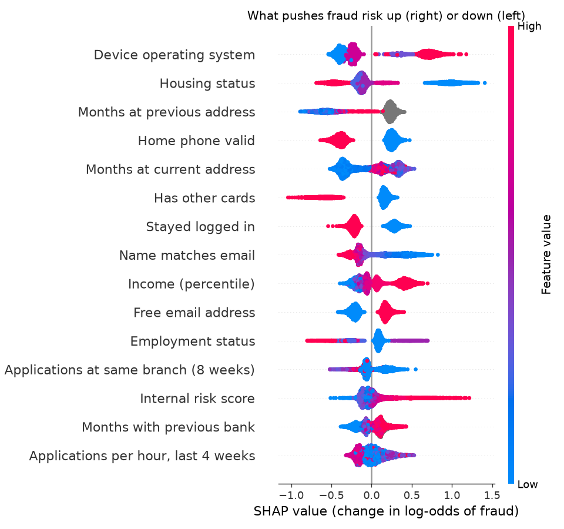

# Model 3: Fraud classifier (model card)

| | |
|---|---|
| **Job** | Gives every application a **fraud probability** and an **alert level** for the *Fraud & documents* gate (gate 3). |
| **Type** | LightGBM with monotonic constraints. **SHAP** values give the reasons. |
| **Trained on** | [Bank Account Fraud (BAF) Base](https://www.kaggle.com/datasets/sgpjesus/bank-account-fraud-dataset-neurips-2022), Feedzai, NeurIPS 2022: 10 lakh account-opening applications, 1.1% fraud |
| **Status** | Trained and validated. It catches **53% of fraud at a 5% false-alarm rate**. False alarms are uneven across age and income groups: [read fairness](#fairness) before any live use. |
| **Version** | `fraud-v1`, trained 5 Nov 2026 (170 trees) |
| **Owner** | AI/ML member |

## Why BAF and not Indian data

We searched for public Indian data of loan or account applications with fraud labels and found none:
- **RBI and data.gov.in** publish only totals, by bank, state and year.
- **AIKosh, research archives and Hugging Face** had no labelled application data.
- **Kaggle's Indian fraud sets** are synthetic **card transactions** with rule-made labels.

Indian lenders keep fraud cases private under the DPDP Act and banking secrecy.

BAF is the closest realistic match. It's **application fraud**, the same job as our Fraud gate. It was generated from a real bank's data with privacy protection: noise was added, and the rows were produced by a generative model trained on that data (CTGAN). It also comes with the exact benchmark we planned: **fraud caught at a fixed 5% false-alarm rate**.

**Licence:** CC BY-NC-SA 4.0, so non-commercial use only, with credit. The data stays in `data/raw/baf/`, and Git ignores it. **Citation:** Jesus et al., *Turning the Tables: Biased, Imbalanced, Dynamic Tabular Datasets for ML Evaluation*, NeurIPS 2022.

## What it does in the engine

| Alert | When | Engine action | Reason code |
|---|---|---|---|
| `clear` | Below the review threshold | Carries on to the next gate | – |
| `review` | At or above the threshold set for **5%** false alarms | **Refer** to the fraud team | `R-FRD-01` |
| `high` | At or above the threshold set for **1%** false alarms | **Refer**, at the top of the fraud team's queue | `R-FRD-01` |

**The model never declares fraud and never rejects on its own.** RBI's fraud risk rules (2024) require that a borrower be heard before an account is classed as fraud. Under PMLA, the customer must also not be tipped off. So an alert sends the application to a person, and the customer sees only: *"Your application needs some more review. We will contact you within one working day."*

## Inputs, mapped to Nirnay's checks in India

| Group | BAF input | Nirnay check in India |
|---|---|---|
| Identity and contact | Name matches email | PAN name vs email ID |
| | Mobile number valid / home phone valid | Mobile OTP verified / alternate number verified |
| | Months at current / previous address | Address tenure (Aadhaar, utility bill) |
| | Months with previous bank | Age of salary account (Account Aggregator) |
| | Free email address | Gmail/Yahoo vs company email |
| Application bursts | Emails used with the same date of birth (4 weeks) | Same DOB and PAN seen with other emails |
| | Applications from the same pincode / branch | Pincode and branch/DSA bursts |
| | Applications per hour (6h / 24h / 4 weeks) | Platform-wide application rate |
| Device and session | Emails used on the same device (8 weeks) | One device shared across applicants |
| | Device OS, session length, stayed logged in, channel | App/browser device, time spent filling the form, app vs DSA |
| | Request from abroad | Non-Indian IP address |
| Applicant profile | Income, employment, housing, internal risk score, other cards, amount asked, initial amount paid, payment plan | Declared income, salaried/self-employed, owned/rented home, bureau score, cards in bureau, loan amount, own contribution, EMI plan |

**What's left out:**
- **Age.** See the trade-off below.
- **`device_fraud_count`.** It's always 0 in BAF, so it carries no information.
- **`month`.** It's only used to split the data by time.

**About BAF's categories:** they're coded (housing `BA`–`BG`, employment `CA`–`CG`), so some reasons read as codes. On a real loan book, these would be real categories.

**Monotonic constraints** apply where the direction is obvious:
- A **better name–email match** or a **verified phone** can only *lower* risk.
- **More emails** sharing a date of birth or a device, or a **request from abroad**, can only *raise* it.

As with model 2, we use LightGBM's strict `basic` method. Training sweeps those inputs across 50 real applications and stops if risk ever moves the wrong way. It found none.

## How it was trained and tested

The split follows the BAF paper, strictly by time:
- **Learn** on months 0–4 (6,75,666 applications).
- **Choose** the number of trees *and* the alert thresholds on month 5 (1,19,323).
- **Test** once, on months 6–7 (2,05,011 applications, 2,878 frauds, 1.40%).

The thresholds are never tuned on the test months, so the results show how they behave on new months.

## Results (test months 6–7)

| Measure | Result |
|---|---|
| AUC | **0.890** (train 0.937) |
| **Fraud caught at a 5% false-alarm rate** | **53.3%** |
| Fraud caught at a 1% false-alarm rate | 23.8% |

The 53% is in line with the strong baselines reported for BAF Base.

**The alert levels in practice** (`reports/alerts.csv`), using thresholds fixed on month 5:

| Alert | Applications flagged | Fraud caught | Honest applicants flagged | Flagged that were fraud |
|---|---|---|---|---|
| `review` or above | 6.7% | **56.8%** (1,635 of 2,878) | **6.0%** (12,045) | 12% (about 1 in 8) |
| `high` | 1.7% | 28.2% (812) | 1.3% (2,682) | 23% (about 1 in 4) |

- **The false-alarm rate drifted** from the 5% target to 6.0% on the test months: 6.4% in month 6 and 5.4% in month 7 (`reports/by_month.csv`). Fraud patterns shift over time, so the thresholds need **monthly re-checking**.
- **Every flag costs an officer's time.** At the `review` level, the fraud team would see about **7 honest applicants for every fraud**. The `high` level is a much tighter queue, about 3 honest applicants per fraud.

## What drives the score

`reports/shap_importance.csv` and the chart below show what drives the score. The **device OS**, **housing status** and **address history** matter most. Next come the **home phone check**, **other cards**, **staying logged in**, the **name–email match** and **income**.



Each dot is one application. Dots to the right raised its fraud risk. Red means a high value of the input, blue a low one. For example, a low name–email match (blue) pushes fraud risk up.

## Fairness

The table shows how many **honest** applicants get flagged in each group, at the `review` threshold (`reports/fairness.csv`).

| Group | Honest applicants flagged | Fraud caught | Fraud rate in the group |
|---|---|---|---|
| **Age 50 and over** | **10.2%** | 64.8% | 2.9% |
| Age under 50 | 5.1% | 52.6% | 1.1% |
| **Income: high** | **8.2%** | 61.2% | 1.8% |
| Income: middle | 3.6% | 45.4% | 1.0% |
| Income: low | 2.6% | 44.3% | 0.7% |

**Age.** Honest applicants aged 50+ are flagged **twice as often** as younger ones (ratio 0.50), even though age is **not an input**. Other inputs still carry age information. In BAF, fraud really is more common among older applicants (2.9% against 1.1%), which is part of the reason. But it means more honest older customers wait for a fraud review.

**Including age would make the gap worse:**

| | Fraud caught at 5% false alarms | Honest 50+ flagged | Honest under-50 flagged | Ratio |
|---|---|---|---|---|
| With age | 54.1% | 13.6% | 4.2% | 0.31 |
| **Without age (shipped)** | 53.3% | **10.2%** | 5.1% | **0.50** |

Leaving age out costs just 0.8 points of fraud caught, and flags a quarter fewer honest older applicants.

**Income and employment.** High-income applicants are flagged about 3 times as often as low-income ones (ratio 0.32). Some employment codes are far apart: 11.6% for `CC` against 0.4% for `CF`.

**What this means for go-live:**
- An alert only ever sends an application to a person. It never rejects.
- The gaps have to be reviewed by the model risk committee.
- Options to fix them include fairness-aware training and checking the false-alarm rate by group every month.
- Setting different thresholds per age group would narrow the gap, but it would mean using age in the decision itself. That's a policy call, not a modelling one.

## Output (what the Fraud gate receives)

`example_input.json`, a suspicious application:
- weak name–email match
- 3 months at the address
- free email
- no home phone
- no bank history

```json
{
  "model": "fraud_classifier",
  "model_version": "fraud-v1",
  "trained_on": "baf",
  "fraud_probability": 0.29399,
  "alert": "high",
  "flag": "refer",
  "reason_code": "R-FRD-01",
  "thresholds": {"review": 0.02938, "high": 0.10082},
  "contributions": [{"input": "name_email_similarity", "label": "Name matches email",
                     "india_check": "PAN name vs email ID", "value": 0.05, "shap": 0.69111}, "..."],
  "top_reasons": ["Housing status (BA): check Owned / rented / family home",
                  "Device operating system (windows): check App / browser device",
                  "Name matches email (0.05): check PAN name vs email ID"]
}
```

The same application with an honest-looking profile scores **0.00068 (`clear`)**:
- strong name–email match
- 140 months at the address
- company email
- verified home phone
- 24 months with the bank

**Inputs and codes:**
- Negative "missing" codes such as `-1` count as missing.
- An unknown category counts as missing.
- Each reason names the **Indian check** the fraud team should run.

## Run it

```bash
.venv\Scripts\python -m pip install -r models/fraud_classifier/requirements.txt
```
```bash
.venv\Scripts\python -m models.fraud_classifier.train
```
```bash
.venv\Scripts\python -m models.fraud_classifier.fraud models/fraud_classifier/example_input.json
```

**Before training:** put BAF's `Base.csv`, or its zip, in `data/raw/baf/`. Training takes about 1 minute.

**Tests:** 18 tests on made-up data, all run by `.venv\Scripts\python -m pytest`. They check that:
- the alert thresholds come from month 5,
- an alert only ever refers, never rejects,
- the SHAP values add up to the probability,
- constrained inputs never move risk the wrong way,
- `-1` counts as missing,
- age is never an input,
- the model file has no Windows line endings.

## Next steps

- **Retrain on the lender's own confirmed fraud cases**, Indian applications labelled by its fraud team, before going live.
- **Re-check thresholds monthly.** The false-alarm rate drifted from 5% to 6% within two months.
- **Work on the age and income gaps** with the model risk committee.
- **Add model 4, the anomaly detector**, for new fraud patterns that have no labels yet.
